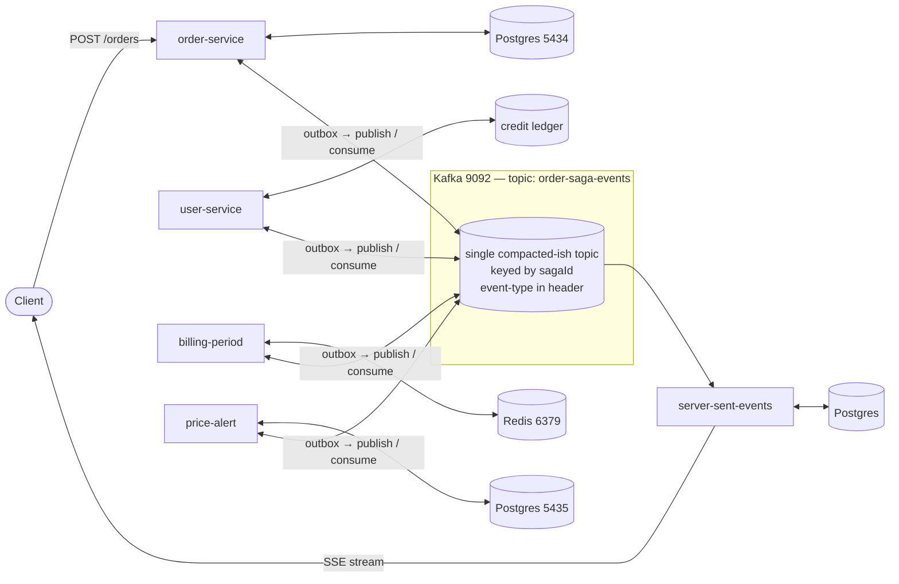
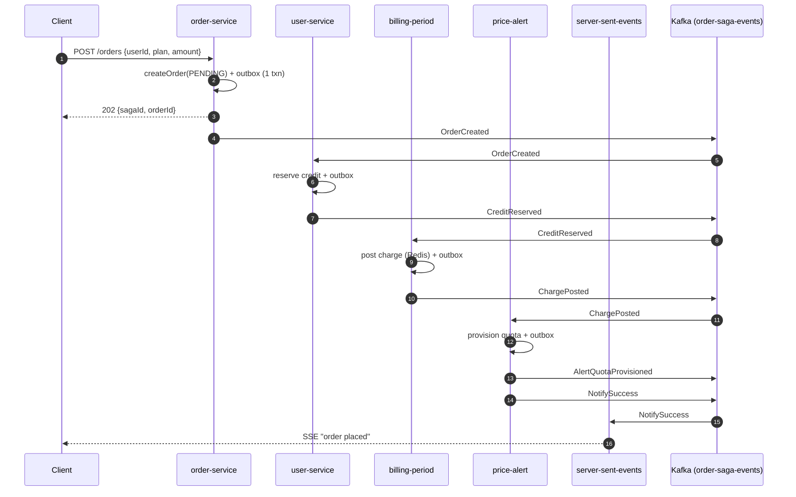
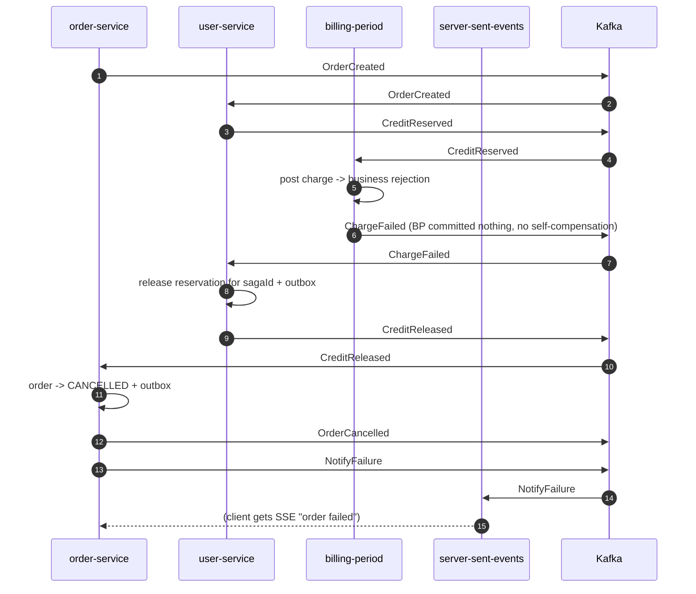

# Saga Pattern — Choreography Design

A worked design for the same **"Place Order"** distributed transaction as
[`SAGA_ORCHESTRATION_DESIGN.md`](./SAGA_ORCHESTRATION_DESIGN.md), but with **no central
coordinator**. Each service reacts to events on Kafka, does its local work, and emits the
next event. Failure events flow back through the chain and each service compensates its own
step.

Infrastructure reused from the repo: **Kafka** (`spring-kafka`, `localhost:9092`),
**Postgres** (per service — `outbox-pattern` `5434`, `price-alert` `5435`), **Redis**
(`billing-period` / `spring-redis`, `6379`), and the **transactional outbox** mechanism
from the `outbox-pattern` module.

---

## 1. Business flow (identical to the orchestration doc)

| # | Step | Owning service | Store |
|---|------|----------------|-------|
| 1 | Create order `PENDING` | `order-service` / `outbox-pattern` | Postgres `5434` |
| 2 | Reserve customer credit | `user-service` | credit ledger |
| 3 | Post charge to billing period | `billing-period` | Redis `6379` |
| 4 | Provision paid alert quota | `price-alert` | Postgres `5435` + Redis |
| 5 | Notify customer | `server-sent-events` | Kafka → SSE |

| Step | "Done" event | Compensating event it listens for |
|------|--------------|-----------------------------------|
| 1 | `OrderCreated` | `OrderCancelledRequested` → sets order `CANCELLED`, emits `OrderCancelled` |
| 2 | `CreditReserved` | `CreditReleaseRequested` → `CreditReleased` |
| 3 | `ChargePosted` | `ChargeReversalRequested` → `ChargeReversed` |
| 4 | `AlertQuotaProvisioned` | `AlertQuotaRevokeRequested` → `AlertQuotaRevoked` |
| 5 | terminal | — |

---

## 2. Core idea: the event chain and its reverse

Forward, each service listens for the **previous** service's success event and publishes
its own:

```
OrderCreated ─▶ CreditReserved ─▶ ChargePosted ─▶ AlertQuotaProvisioned ─▶ NotifySuccess
```

Any service that **fails its own step** publishes a `*.Failed` event instead. Every service
in the chain listens for failure events and, if it had already completed its step, emits
its own compensation-requested event — producing a reverse cascade:

```
ChargeFailed
   │  (billing-period had NOT committed, nothing to undo)
   ├─▶ user-service      hears ChargeFailed  ─▶ CreditReleaseRequested ─▶ CreditReleased
   └─▶ order-service     hears CreditReleased ─▶ OrderCancelledRequested ─▶ OrderCancelled ─▶ NotifyFailure
```

There is no shared saga table. The **only** shared state is the `sagaId` (a correlation id)
carried in every event, plus each service's own record of "what did I do for this sagaId".

---

## 3. Architecture



Each `<->` is: **consume** the predecessor/failure event → local transaction (business
write **+** outbox row) → `OutboxProcessor` publishes the next event.

### Topic layout

Two viable options:

| Option | Layout | Trade-off |
|--------|--------|-----------|
| **A (recommended here)** | one topic `order-saga-events`, `eventType` in a Kafka header, keyed by `sagaId` | strict per-saga ordering, one listener config per service, easy to trace; every service sees every event and filters |
| B | topic-per-event-type (`order.created`, `credit.reserved`, …) | less filtering, but ordering across types is not guaranteed and wiring grows |

With Option A, every service runs **one** `@KafkaListener(topics = "order-saga-events")`
and `switch`es on the `eventType` header. Consumers use **distinct group ids** so each
service gets its own copy: `order-saga-order`, `order-saga-credit`, `order-saga-billing`,
`order-saga-alert`, `order-saga-notify`.

---

## 4. Event contract

JSON string value (consistent with `price-alert` / `server-sent-events` `StringSerializer`
setup). Kafka message **key = `sagaId`**; Kafka **headers** carry `eventType` and
`eventId`.

```json
{
  "sagaId": "b1f2...-uuid",
  "eventId": "e-0001",
  "eventType": "CreditReserved",
  "occurredAt": "2026-09-02T10:15:31Z",
  "causationId": "e-0000",
  "order": { "orderId": 9001, "userId": 42, "amount": 199.00, "currency": "USD" },
  "stepResult": { "creditReservationId": "cr-7788" }
}
```

Event types:

| Forward | Failure | Compensation-requested | Compensation-done |
|---------|---------|------------------------|-------------------|
| `OrderCreated` | `OrderCreationFailed` | `OrderCancelledRequested` | `OrderCancelled` |
| `CreditReserved` | `CreditReservationFailed` | `CreditReleaseRequested` | `CreditReleased` |
| `ChargePosted` | `ChargeFailed` | `ChargeReversalRequested` | `ChargeReversed` |
| `AlertQuotaProvisioned` | `AlertQuotaFailed` | `AlertQuotaRevokeRequested` | `AlertQuotaRevoked` |
| `NotifySuccess` / `NotifyFailure` | — | — | — |

---

## 5. Per-service reaction rules

Each service is a small rules table: **on event X → do Y → emit Z**. The whole saga is the
union of these tables; no one component holds the full picture.

### order-service (`group: order-saga-order`)

| On | Action | Emit |
|----|--------|------|
| *(REST `POST /orders`)* | `orderService.createOrder()` (status `PENDING`) + outbox | `OrderCreated` |
| `CreditReleased` | set order `CANCELLED` | `OrderCancelled` |
| `CreditReservationFailed` | set order `CANCELLED` (nothing downstream ran) | `OrderCancelled` |
| `OrderCancelled` | *(also)* build failure notification | `NotifyFailure` |

### user-service (`group: order-saga-credit`)

| On | Action | Emit |
|----|--------|------|
| `OrderCreated` | reserve credit in ledger (idempotent) | `CreditReserved` **or** `CreditReservationFailed` |
| `ChargeFailed` | release the reservation for this `sagaId` | `CreditReleased` |
| `AlertQuotaFailed` | release the reservation | `CreditReleased` |

### billing-period (`group: order-saga-billing`)

| On | Action | Emit |
|----|--------|------|
| `CreditReserved` | `billingPeriodService` posts charge (Redis) | `ChargePosted` **or** `ChargeFailed` |
| `AlertQuotaFailed` | reverse the charge for this `sagaId` | `ChargeReversed` |

### price-alert (`group: order-saga-alert`)

| On | Action | Emit |
|----|--------|------|
| `ChargePosted` | provision quota (Postgres + Redis cache) | `AlertQuotaProvisioned` **or** `AlertQuotaFailed` |
| *(quota is the last forward step)* | on `AlertQuotaProvisioned` also | `NotifySuccess` |

### server-sent-events (`group: order-saga-notify`)

| On | Action |
|----|--------|
| `NotifySuccess` | `sseNotificationService.sendNotification(SAGA_ORDER_PLACED)` |
| `NotifyFailure` | `sseNotificationService.sendNotification(SAGA_ORDER_FAILED)` |

> The existing `NotificationEventConsumer` already consumes `notification-events`. Keep that:
> `order-service` / `price-alert` translate `NotifySuccess`/`NotifyFailure` into the
> `NotificationEvent` shape and publish to `notification-events` — SSE is unchanged.

---

## 6. Reliability mechanics

Choreography has **no coordinator**, so each of these must be enforced *locally* by every
participant.

### 6.1 Atomic write + publish — transactional outbox (mandatory)

Every service copies `outbox-pattern`'s approach: the business write **and** the outbox row
commit in **one local transaction**; a per-service `OutboxProcessor` (`@Scheduled`) then
publishes to Kafka and marks the row `PROCESSED`.

```sql
-- added to each participant's schema (order-service already has orders in 5434)
CREATE TABLE saga_outbox (
    id           BIGSERIAL PRIMARY KEY,
    saga_id      UUID NOT NULL,
    event_type   VARCHAR(64) NOT NULL,
    payload      TEXT NOT NULL,
    status       VARCHAR(16) NOT NULL DEFAULT 'PENDING',
    created_at   TIMESTAMPTZ NOT NULL DEFAULT now(),
    processed_at TIMESTAMPTZ
);
```

`billing-period` is Redis-only — it needs a tiny relational outbox (embedded H2 or a shared
Postgres), **or** it writes its charge into Redis and the outbox row into Redis in a
`MULTI/EXEC` transaction and a scheduled relay publishes from a Redis list. Recommended:
give `billing-period` a small Postgres for the outbox; keep charges in Redis.

### 6.2 Idempotent consumption (Redis, `6379`)

Kafka is at-least-once; every listener will occasionally see a duplicate. Before acting:

```
SET saga:seen:{group}:{sagaId}:{eventType} 1 NX EX 604800
```

If the key exists → the event was already handled; **re-publish the same outcome event**
(each service stores its own emitted event by `(sagaId, eventType)`), then ack. This makes
every reaction rule replay-safe.

Also store the **processed event outcome** so a redelivered `OrderCreated` doesn't create a
second reservation — key the ledger write on `sagaId` (`INSERT ... ON CONFLICT (saga_id)
DO NOTHING`).

### 6.3 Ordering

Single topic, key = `sagaId` → all events for one saga land in one partition and are
consumed in order per group. Forward events therefore always arrive after their cause.
Compensation events are also keyed by `sagaId`, so they interleave correctly with any
in-flight forward events for that saga.

### 6.4 Detecting a stalled saga (the hard part of choreography)

No component owns "the saga should have finished by now". Options, in increasing effort:

1. **Timeout sentinel service (recommended):** a tiny `saga-watchdog` consumer on
   `group: order-saga-watch` records `sagaId → lastEventType, lastSeenAt` in Redis
   (`HSET saga:progress {sagaId} ...`, `EXPIRE`). A `@Scheduled` sweep finds sagas whose
   `lastSeenAt` is older than `T` and not in a terminal state, and emits a
   `<lastStep>Failed` event to kick off compensation. This is *observability only* — it
   holds no workflow logic, so it doesn't reintroduce an orchestrator.
2. **Per-step deadline events:** when a service emits its forward event it also schedules
   (via `spring-schedular` / a Redis ZSET of `dueAt → sagaId`) a check that the next event
   arrived; if not, emit the failure. More distributed but no extra service.
3. **Nothing** — accept that a crashed mid-chain saga stays half-done until an operator
   runs a reconciliation query. Only acceptable for low volume.

### 6.5 Compensation must not fail

Same contract as the orchestration design: `*RevokeRequested` / `*ReleaseRequested` /
`*ReversalRequested` handlers are idempotent and retried by the outbox/consumer until they
succeed. A genuinely impossible compensation emits a `ManualInterventionRequired` event
that `server-sent-events` (or a Slack sink) surfaces.

### 6.6 The "which failures do I care about?" rule

To avoid every service subscribing to every failure, each service compensates only when it
sees the **failure/compensation event from the step immediately downstream of its own**:

- `user-service` (step 2) compensates on `ChargeFailed` or `CreditReleaseRequested`.
- `order-service` (step 1) compensates on `CreditReleased` or `CreditReservationFailed`.
- `billing-period` (step 3) compensates on `AlertQuotaFailed`.

This keeps the reverse cascade a simple chain instead of a fan-out.

---

## 7. Happy path



## 8. Failure path (step 3, `billing-period`, fails)



---

## 9. Local run topology

| Process | Port | Start with |
|---------|------|-----------|
| Kafka | `9092` | `spring-kafka` compose (or `price-alert/docker-compose.yml`) |
| Postgres — orders + order-service outbox | `5434` | `outbox-pattern/docker-compose.yml` |
| Postgres — price-alert | `5435` | `price-alert/docker-compose.yml` |
| Postgres — user-service / billing outbox | `5442` | `spring-postgres` compose (reuse) |
| Redis | `6379` | `spring-redis` / `billing-period` compose |
| `saga-watchdog` (optional) | `8091` | new tiny module |
| participants | existing ports | `./gradlew bootRun` per module |

A root `docker-compose.saga-choreography.yml` bundling Kafka + the Postgres instances +
Redis makes it one command.

---

## 10. Implementation plan (phased)

### Phase 0 — contract & infra (0.5 day)
1. Define the event envelope (section 4) as a shared record (`saga-events` mini-module or
   copied class) + the `eventType`/`eventId` header constants.
2. Create topic `order-saga-events` (3 partitions). Add
   `docker-compose.saga-choreography.yml`.
3. Add `saga_outbox` table + a copied `OutboxProcessor` to each participant. `billing-period`
   gets a small Postgres (port `5442` reuse) for its outbox only.

### Phase 1 — forward chain (1.5 days)
4. `order-service`: publish `OrderCreated` from `createOrder` via outbox; add
   `@KafkaListener("order-saga-events", groupId="order-saga-order")` (switch on header).
5. `user-service`: add `CreditLedger` (`ON CONFLICT (saga_id) DO NOTHING`), listener
   `order-saga-credit`, emit `CreditReserved` / `CreditReservationFailed`.
6. `billing-period`: listener `order-saga-billing`, wrap `BillingPeriodService`, emit
   `ChargePosted` / `ChargeFailed`.
7. `price-alert`: listener `order-saga-alert`, provision quota, emit
   `AlertQuotaProvisioned` + `NotifySuccess`.
8. `server-sent-events`: map `NotifySuccess`/`NotifyFailure` → `NotificationEvent` on
   `notification-events`; add `EventType.SAGA_ORDER_PLACED` / `SAGA_ORDER_FAILED`.

### Phase 2 — reverse chain (1 day)
9. Add the compensation rules from section 5 to `user-service` and `order-service`
   (and `billing-period` for the `AlertQuotaFailed` case).
10. Idempotency guard (`SET NX`) + stored-outcome replay in every listener.

### Phase 3 — stall detection & hardening (1 day)
11. `saga-watchdog`: Redis progress hash + `@Scheduled` sweep that emits `<lastStep>Failed`
    for sagas idle > `T`.
12. Metrics via actuator: events consumed/emitted per type, outbox lag per service,
    watchdog-fired count. Reconciliation query per service: "rows with no terminal event".

---

## 11. Testing strategy

| Level | Tooling (in repo) | What it proves |
|-------|-------------------|----------------|
| Reaction-rule unit tests | JUnit, no infra (`spring-tdd` style) | each `on event → emit event` mapping, incl. failure branches |
| Idempotency tests | `@SpringBootTest` + embedded Redis/H2 | same event delivered twice → one side effect, same emitted event |
| Per-pair slice | `@EmbeddedKafka` (`spring-kafka-test`) | `OrderCreated` in → `CreditReserved` out; `ChargeFailed` in → `CreditReleased` out |
| End-to-end happy | `docker-compose.saga-choreography.yml` + REST | chain runs to `NotifySuccess`, SSE received |
| End-to-end failure | forced `ChargeFailed` flag in `billing-period` | reverse cascade → order `CANCELLED`, credit released, `NotifyFailure` |
| Stall test | kill `price-alert` after `ChargePosted` | `saga-watchdog` emits `AlertQuotaFailed`, compensation completes |
| Duplicate-delivery test | replay a Kafka offset | no double reservation / double charge |

---

## 12. Pros & cons of choreography (this design)

**Pros**
- **No new coordinator service** on the critical path — one less thing to deploy and keep
  available. (The optional `saga-watchdog` is observability, not workflow.)
- Services are loosely coupled: each only knows "my predecessor's event" and "my
  downstream's failure". Adding a consumer (analytics, audit) is free.
- Lower latency for the happy path — events flow straight service-to-service, no
  orchestrator round-trip.
- Naturally resilient: each hop is an independent at-least-once + outbox + idempotency
  unit; a crash resumes from the last committed outbox row.

**Cons**
- **The workflow exists only as the sum of scattered rules** — no single file shows the
  end-to-end flow; onboarding and change-impact analysis are harder.
- **Cyclic-coupling risk:** every service ends up subscribing to several event types;
  reordering or inserting a step means editing multiple services.
- **Stall detection is genuinely hard** — nobody owns "this saga is late". Needs the
  watchdog or per-step deadline events, which is complexity creeping back.
- Harder to answer "what's the status of saga X?" — must query each service or build a
  read-model projector off the event topic.
- Compensation reasoning is distributed: easy to get the "which failure do I react to"
  matrix subtly wrong and either double-compensate or miss a step.

Choose choreography when the flow is a **short, stable, linear chain** with few steps and
you value decoupling and no central component. Choose
[orchestration](./SAGA_ORCHESTRATION_DESIGN.md) when the flow **branches, changes often,
has many steps, or needs first-class status, retry, and operator recovery**.

---

## 13. Orchestration vs. choreography — quick reference

| Dimension | Orchestration | Choreography |
|-----------|---------------|--------------|
| Workflow definition | one `SagaDefinition` file | emergent from per-service rules |
| New infra to run | `saga-orchestrator` + its Postgres | none (optional `saga-watchdog`) |
| Coupling | star (all → orchestrator) | chain (service → next) |
| Status / "where is saga X" | `GET /sagas/{id}` | build a projector or query each service |
| Add / reorder a step | edit orchestrator only | edit every affected service |
| Happy-path latency | +1 round-trip per step | minimal |
| Stall detection | built in (orchestrator knows the path) | needs watchdog / deadline events |
| Best for | many steps, branching, operator control | few steps, stable, linear, max decoupling |
| Shared mechanics (both) | Kafka transport, transactional outbox (`outbox-pattern`), Redis idempotency keys, idempotent + always-succeeding compensations, `sagaId` correlation |
