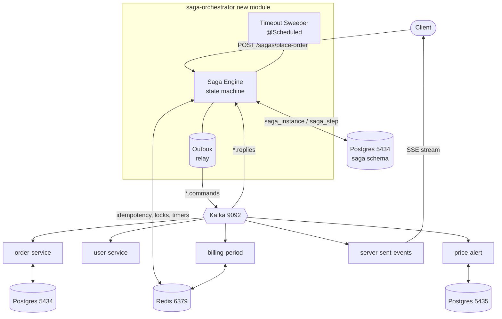
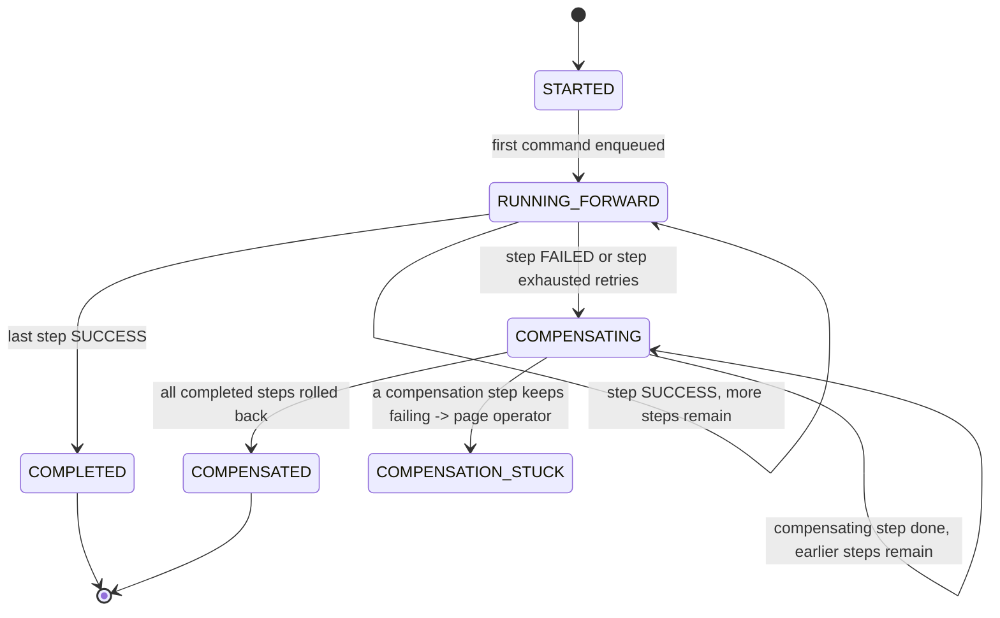
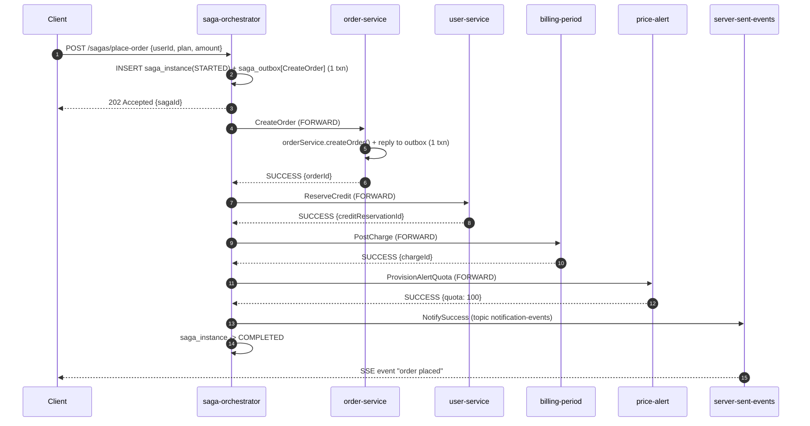
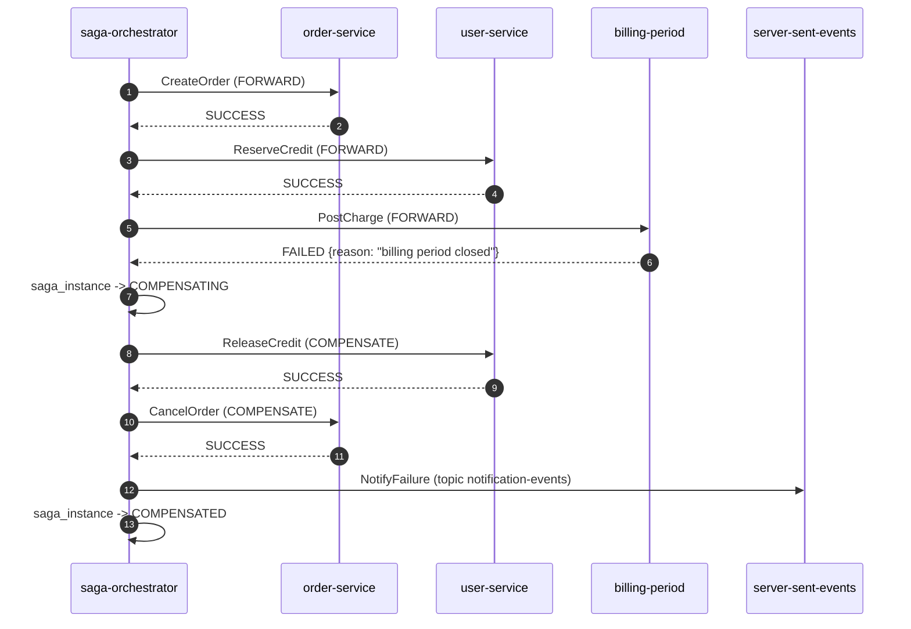

# Saga Pattern — Orchestration Design

A worked design for adding a **distributed saga** to this mono-repo using the services and
infrastructure that already exist (Postgres, Redis, Kafka). This document covers the
**orchestration** variant: one central component (`saga-orchestrator`) owns the workflow,
issues commands to each participant, and drives compensation on failure.

The **choreography** variant of the same business flow is in
[`SAGA_CHOREOGRAPHY_DESIGN.md`](./SAGA_CHOREOGRAPHY_DESIGN.md). Read the comparison section
at the end of either doc to choose between them.

---

## 1. Business flow being made transactional

**"Place Order"** — a customer buys a premium plan. Five things must all happen, or none
of them may stick:

| # | Step | Owning service (existing module) | Data store it touches |
|---|------|----------------------------------|-----------------------|
| 1 | Create the order in `PENDING` state | `order-service` / `outbox-pattern` | Postgres (`5434`) |
| 2 | Validate the customer & reserve credit | `user-service` | in-memory / REST (Postgres-ready) |
| 3 | Post a charge to the current billing period | `billing-period` | Redis (`6379`) |
| 4 | Provision the customer's paid alert quota | `price-alert` | Postgres (`5435`) + Redis |
| 5 | Notify the customer | `server-sent-events` | Kafka (`notification-events`) → SSE |

There is no distributed transaction across Postgres + Redis + a REST service, so we make
the flow **eventually consistent** with a saga: each step has a **compensating action**
that semantically undoes it.

| Step | Forward command | Compensating command |
|------|-----------------|----------------------|
| 1 | `CreateOrder` | `CancelOrder` (status → `CANCELLED`) |
| 2 | `ReserveCredit` | `ReleaseCredit` |
| 3 | `PostCharge` | `ReverseCharge` |
| 4 | `ProvisionAlertQuota` | `RevokeAlertQuota` |
| 5 | `NotifySuccess` | *(none — terminal; on failure send `NotifyFailure` instead)* |

Compensation runs in **reverse order** from the last successfully completed step back to
step 1.

---

## 2. What we reuse vs. what we add

### Reused as-is (infrastructure)

| Component | Source in repo | Role in the saga |
|----------|----------------|------------------|
| Kafka | `spring-kafka` (`localhost:9092`) | Command & reply transport between orchestrator and participants |
| Postgres | `outbox-pattern` compose (`5434`, `outboxdb`) | Orchestrator's durable saga-state store |
| Redis | `billing-period` (`6379`) | Idempotency keys, step-timeout tracking, per-saga advisory lock |
| Transactional outbox | `outbox-pattern` module (`OutboxEvent`, `OutboxProcessor`) | Pattern each participant copies to publish replies atomically with its local write |

### Reused with a thin adapter (participants)

Each participant service gains **one Kafka listener** (the command handler) and reuses the
`outbox-pattern` mechanism to publish its reply. No business logic moves.

| Service | New class | Wraps existing code |
|---------|-----------|---------------------|
| `order-service` | `OrderSagaCommandHandler` | `OrderService.createOrder(...)` |
| `user-service` | `CreditSagaCommandHandler` | `UserController` account lookup + a new `CreditLedger` |
| `billing-period` | `BillingSagaCommandHandler` | `BillingPeriodService` |
| `price-alert` | `AlertQuotaSagaCommandHandler` | `AlertCacheService` / `PriceAlertService` |
| `server-sent-events` | *(already a Kafka consumer)* | `SseNotificationService` — just add a `SAGA_*` event type |

### New module: `saga-orchestrator`

A small Spring Boot service (Boot 3.5.x, Java 21 — match `billing-period`). Responsibilities:

- Expose `POST /sagas/place-order` to start a saga.
- Persist and advance saga state (Postgres).
- Publish forward / compensating commands to Kafka.
- Consume replies, decide the next transition.
- Detect stuck steps via a timeout sweeper and trigger compensation.
- Expose `GET /sagas/{id}` for status and `POST /sagas/{id}/retry` for operator recovery.

---

## 3. Architecture



### Kafka topics

| Topic | Producer | Consumer | Key |
|-------|----------|----------|-----|
| `saga.order.commands` | orchestrator | order-service | `sagaId` |
| `saga.order.replies` | order-service | orchestrator | `sagaId` |
| `saga.credit.commands` / `.replies` | ↔ user-service | | `sagaId` |
| `saga.billing.commands` / `.replies` | ↔ billing-period | | `sagaId` |
| `saga.alert.commands` / `.replies` | ↔ price-alert | | `sagaId` |
| `notification-events` *(existing)* | orchestrator | server-sent-events | `userId` |

Keying every message by `sagaId` gives per-saga ordering within a partition. Start with
**3 partitions** per topic; the orchestrator listener is single-consumer-group
(`saga-orchestrator`).

---

## 4. Message contracts

All messages are JSON strings (matches the `StringSerializer` setup already used in
`price-alert` and `server-sent-events`).

### Command envelope (orchestrator → participant)

```json
{
  "sagaId": "b1f2...-uuid",
  "stepName": "RESERVE_CREDIT",
  "commandType": "ReserveCredit",
  "direction": "FORWARD",
  "idempotencyKey": "b1f2...-RESERVE_CREDIT-FORWARD",
  "issuedAt": "2026-09-02T10:15:30Z",
  "payload": {
    "userId": 42,
    "orderId": 9001,
    "amount": 199.00,
    "currency": "USD"
  }
}
```

`direction` is `FORWARD` or `COMPENSATE`; the participant routes on `commandType`.

### Reply envelope (participant → orchestrator)

```json
{
  "sagaId": "b1f2...-uuid",
  "stepName": "RESERVE_CREDIT",
  "status": "SUCCESS",            // SUCCESS | FAILED | RETRYABLE_ERROR
  "direction": "FORWARD",
  "idempotencyKey": "b1f2...-RESERVE_CREDIT-FORWARD",
  "completedAt": "2026-09-02T10:15:31Z",
  "result": { "creditReservationId": "cr-7788" },
  "failureReason": null
}
```

- `SUCCESS` → advance to next forward step (or finish).
- `FAILED` → business rejection; begin compensation. **Compensation commands are never
  `FAILED`-able**; a failed compensation is retried forever (with backoff) and alerted.
- `RETRYABLE_ERROR` → transient (DB down, timeout); orchestrator re-sends the same command
  after backoff, up to `maxAttempts`, then treats it as `FAILED`.

---

## 5. Orchestrator state model (Postgres, `5434`)

New schema added to the `outbox-pattern` Postgres instance (or its own DB — a
`saga-orchestrator/src/main/resources/schema.sql` mounted the same way the outbox one is).

```sql
CREATE TABLE saga_instance (
    id              UUID PRIMARY KEY,
    saga_type       VARCHAR(64)  NOT NULL,          -- 'PLACE_ORDER'
    status          VARCHAR(32)  NOT NULL,          -- see state machine below
    current_step    VARCHAR(64),
    payload         JSONB        NOT NULL,          -- the original request + accumulated results
    created_at      TIMESTAMPTZ  NOT NULL DEFAULT now(),
    updated_at      TIMESTAMPTZ  NOT NULL DEFAULT now(),
    version         BIGINT       NOT NULL DEFAULT 0 -- optimistic lock
);

CREATE TABLE saga_step (
    id              BIGSERIAL PRIMARY KEY,
    saga_id         UUID NOT NULL REFERENCES saga_instance(id),
    step_name       VARCHAR(64)  NOT NULL,
    seq             INT          NOT NULL,          -- 1..N forward order
    direction       VARCHAR(16)  NOT NULL,          -- FORWARD | COMPENSATE
    status          VARCHAR(32)  NOT NULL,          -- PENDING|SENT|SUCCESS|FAILED|COMPENSATED
    attempts        INT          NOT NULL DEFAULT 0,
    last_sent_at    TIMESTAMPTZ,
    deadline_at     TIMESTAMPTZ,                    -- for the timeout sweeper
    idempotency_key VARCHAR(160) NOT NULL,
    request_json    JSONB,
    response_json   JSONB,
    UNIQUE (saga_id, step_name, direction)
);

-- Orchestrator's own transactional outbox (copied from outbox-pattern module)
CREATE TABLE saga_outbox (
    id            BIGSERIAL PRIMARY KEY,
    topic         VARCHAR(128) NOT NULL,
    msg_key       VARCHAR(128) NOT NULL,
    payload       TEXT NOT NULL,
    status        VARCHAR(16) NOT NULL DEFAULT 'PENDING',
    created_at    TIMESTAMPTZ NOT NULL DEFAULT now(),
    processed_at  TIMESTAMPTZ
);
CREATE INDEX idx_saga_outbox_poll ON saga_outbox(status, created_at);
CREATE INDEX idx_saga_step_deadline ON saga_step(status, deadline_at);
```

### State machine



The engine is a pure function: `(saga_instance, saga_step[], incoming_reply) -> (new status, commands to emit)`.
Everything it emits goes into `saga_outbox` **in the same transaction** as the state
update, so a crash between "decided" and "sent" cannot lose or double a command.

---

## 6. Reliability mechanics

### 6.1 Atomic decide-then-send (transactional outbox)

The orchestrator never calls `kafkaTemplate.send()` inline. It writes rows to `saga_outbox`
inside the state-transition transaction. A `@Scheduled(fixedDelay = 1000)` `SagaOutboxRelay`
— structurally identical to `outbox-pattern`'s `OutboxProcessor` — publishes `PENDING` rows
and marks them `PROCESSED`. This is **at-least-once**; dedup is handled next.

### 6.2 Idempotency (Redis, `6379`)

Every command carries `idempotencyKey = "{sagaId}-{stepName}-{direction}"`.

- **Participant side:** before doing work, `SET idem:{key} 1 NX EX 86400`. If the key
  already exists, skip the work and re-send the stored reply (participants persist their
  reply keyed by `idempotencyKey`). This makes redelivered commands safe.
- **Orchestrator side:** replies are deduped the same way (`SET idem:reply:{key} NX`)
  before the state machine runs, so a redelivered `SUCCESS` doesn't double-advance.

### 6.3 Per-saga single-writer lock

Two replies for the same saga could be processed concurrently by different partitions /
threads. Guard the state transition with a Redis lock:
`SET lock:saga:{sagaId} {token} NX PX 10000`, released after the transaction. Combined with
the `version` column's optimistic check, a lost lock still cannot corrupt state — the
second writer's `UPDATE ... WHERE version = ?` fails and the reply is re-queued.

### 6.4 Timeouts

When a command is sent, `saga_step.deadline_at = now() + stepTimeout` (default 30 s,
per-step configurable). `SagaTimeoutSweeper` (`@Scheduled(fixedDelay = 5000)`):

```sql
SELECT * FROM saga_step
WHERE status = 'SENT' AND deadline_at < now()
FOR UPDATE SKIP LOCKED;
```

For each: if `attempts < maxAttempts` → re-enqueue the same command (idempotency makes this
safe), bump `attempts`, push `deadline_at`. Else → mark step `FAILED`, move saga to
`COMPENSATING`.

### 6.5 Compensation guarantees

- Compensating commands are **idempotent and always eventually succeed** by contract. If a
  participant genuinely cannot compensate (e.g. money already paid out), it replies
  `SUCCESS` with a `manualInterventionTicket` field and emits a domain alert — the saga is
  still considered `COMPENSATED` from the workflow's point of view.
- If a compensation reply is `RETRYABLE_ERROR` past `maxAttempts`, saga → `COMPENSATION_STUCK`,
  a `NotifyOps` event is published, and `GET /sagas?status=COMPENSATION_STUCK` surfaces it.

### 6.6 Ordering & partitioning

All topics keyed by `sagaId`. The orchestrator's reply listener uses concurrency > 1 but
the Redis lock + optimistic version serialize per-saga writes, so partition rebalances are
safe.

---

## 7. Happy path



## 8. Failure path (step 3 fails)



Note: step 3 (`PostCharge`) failed *before* committing, so it has **no** compensation —
only the steps that reached `SUCCESS` (2, then 1) are rolled back, in reverse.

---

## 9. Local run topology

| Process | Port | Start with |
|---------|------|-----------|
| Kafka + ZooKeeper/KRaft | `9092` | `spring-kafka` compose (or `price-alert/docker-compose.yml`) |
| Postgres (saga + orders) | `5434` | `outbox-pattern/docker-compose.yml` |
| Redis | `6379` | `spring-redis` / `billing-period` compose |
| Postgres (alerts) | `5435` | `price-alert/docker-compose.yml` |
| `saga-orchestrator` | `8090` (proposed) | `cd saga-orchestrator && ./gradlew bootRun` |
| participants | their existing ports | `./gradlew bootRun` per module |

Add a `docker-compose.saga.yml` at repo root that composes Kafka + the two Postgres +
Redis so the whole thing is `docker-compose -f docker-compose.saga.yml up -d`.

---

## 10. Implementation plan (phased)

### Phase 0 — contracts & infra (0.5 day)
1. Create `saga-orchestrator` module (`build.gradle` cloned from `billing-period`, add
   `spring-kafka`, `spring-boot-starter-data-jdbc`, `spring-boot-starter-data-redis`,
   `postgresql`).
2. Add `schema.sql` (section 5) and a `docker-compose.saga.yml`.
3. Publish a shared `saga-contracts` package (envelopes from section 4) — either a tiny
   Gradle module or copy the two records into each participant.

### Phase 1 — orchestrator core (2 days)
4. `SagaDefinition` for `PLACE_ORDER`: ordered list of `StepSpec{name, commandTopic,
   commandType, compensateType, timeout, maxAttempts}`.
5. `SagaEngine.on(reply)` pure transition + `SagaRepository` (JDBC, optimistic `version`).
6. `SagaOutboxRelay` (`@Scheduled`) — copy `outbox-pattern/OutboxProcessor`, swap the
   log-only `publishEvent` for `kafkaTemplate.send(topic, key, payload)`.
7. `SagaReplyListener` `@KafkaListener(topics = "saga.*.replies")` → Redis dedup → lock →
   `SagaEngine` → persist.
8. `SagaController`: `POST /sagas/place-order`, `GET /sagas/{id}`, `GET /sagas?status=`,
   `POST /sagas/{id}/retry`.
9. `SagaTimeoutSweeper` (`@Scheduled`, `FOR UPDATE SKIP LOCKED`).

### Phase 2 — participant adapters (0.5 day each)
10. `order-service`: `OrderSagaCommandHandler` `@KafkaListener("saga.order.commands")` →
    `CreateOrder` / `CancelOrder`, reply via its outbox.
11. `user-service`: add `CreditLedger` (a `Map<Long, BigDecimal>` or a table), handler for
    `ReserveCredit` / `ReleaseCredit`.
12. `billing-period`: handler for `PostCharge` / `ReverseCharge` over `BillingPeriodService`
    (Redis). Guard with the `idem:{key}` check.
13. `price-alert`: handler for `ProvisionAlertQuota` / `RevokeAlertQuota`.
14. `server-sent-events`: add `EventType.SAGA_ORDER_PLACED` / `SAGA_ORDER_FAILED`; the
    existing `NotificationEventConsumer` already delivers it.

### Phase 3 — hardening (1 day)
15. Chaos tests (section 11), Grafana/actuator metrics: sagas started / completed /
    compensated / stuck, step latency, outbox lag.
16. Runbook: how to drive `POST /sagas/{id}/retry` and resolve `COMPENSATION_STUCK`.

---

## 11. Testing strategy

| Level | Tooling (already in repo) | What it proves |
|-------|--------------------------|----------------|
| Engine unit tests | JUnit (`spring-tdd` style, no infra) | Every `(state, reply)` transition, reverse-order compensation, retry caps |
| Participant handler tests | `@SpringBootTest` + H2 / embedded Redis | Idempotent replay: same command twice → one effect, identical reply |
| Orchestrator slice | `spring-kafka-test` `@EmbeddedKafka` + Testcontainers Postgres/Redis | Outbox relay publishes once; reply listener dedups |
| End-to-end happy | `docker-compose.saga.yml` + REST call | `sagaId` reaches `COMPLETED`, SSE event received |
| End-to-end failure | Feature-flag a forced `FAILED` in `billing-period` | Saga reaches `COMPENSATED`, order is `CANCELLED`, credit released |
| Chaos | Kill orchestrator mid-saga; kill a participant; pause Kafka | On restart the sweeper + outbox resume; no double effects |

---

## 12. Pros & cons of orchestration (this design)

**Pros**
- The whole workflow is in one place — readable, testable as a state machine, easy to add a
  step or change order.
- Centralized status (`GET /sagas/{id}`), retry, and operator recovery.
- Participants stay dumb: they only implement `do` + `undo` for their step.
- Timeout / stuck detection is trivial because one component knows the expected path.

**Cons**
- `saga-orchestrator` is a new service to run, deploy, and keep available (mitigated: it's
  stateless apart from Postgres; run 2+ instances, same consumer group).
- It can become a god-service if every workflow's logic piles in — keep one
  `SagaDefinition` per flow, no shared branching.
- More moving parts than choreography for a *simple* linear flow.
- Extra hop: orchestrator ↔ participant round-trips add latency vs. events flowing
  directly service-to-service.

Choose orchestration when the flow has **branching, many steps, or needs visible status
and operator control**. Choose [choreography](./SAGA_CHOREOGRAPHY_DESIGN.md) when the flow
is a **short, stable, linear chain** and you want no central component.
