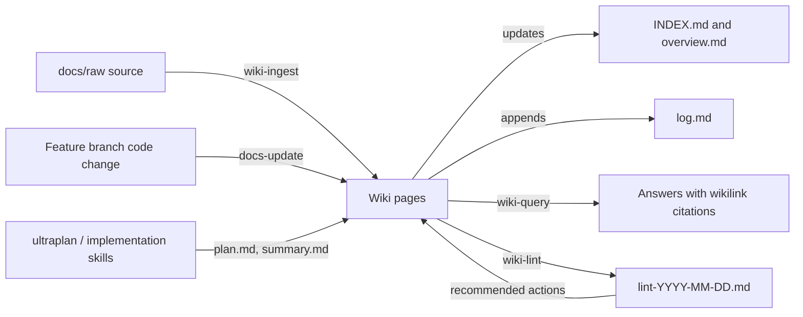

# LLM Wiki — Architecture and Lifecycle

How the `docs/` knowledge base is structured, how Copilot agents create and update pages, and how content is retired.
Schema source: `CLAUDE.md` and `.claude/wiki-schema.md`. Skills: `.claude/skills/wiki-ingest`, `wiki-query`, `wiki-lint`, `docs-update`.

---

## 1. What `docs/.obsidian/` is

`docs/` is an **Obsidian vault**. The `.obsidian/` folder only holds viewer settings
(`app.json`, `appearance.json`, `core-plugins.json`, `graph.json`, `workspace.json`).
It contains **no wiki content** and agents never read or write it.

- `.obsidian/` is git-ignored (`.gitignore` line 2), so these settings are local to each machine.
- Open the `docs/` folder itself in Obsidian to get graph view, backlinks and `[[wikilink]]` navigation.

---

## 2. Three-layer architecture

| Layer | Location | Owner | Mutability |
|-------|----------|-------|-----------|
| **1. Raw sources** | `docs/raw/` | Humans | Immutable — agents read, never modify |
| **2. Wiki pages** | `docs/architecture/`, `decisions/`, `engineering/`, `specs/`, plus `support/`, `testing/`, `defects/` | LLM agents | Created and updated by agents; humans mostly read |
| **3. Schema** | `CLAUDE.md` and `.claude/wiki-schema.md` + `.claude/skills/*` | Humans | Defines structure, naming, templates, workflows |

> Note: `docs/raw/` is defined in the schema but does not currently exist on disk. It is created when the first source is dropped in.

### Structural files

| File | Role | Update rule |
|------|------|-------------|
| `home.md` | Project orientation and section links | Edited only when project-level facts change |
| `INDEX.md` | Master catalog of every wiki page | **Updated on every ingest** |
| `log.md` | Chronological record of operations | **Append-only** — never overwrite |
| `<section>/overview.md` | Short description and wikilink index of a section | Append to the index; no detailed content |
| `lint-YYYY-MM-DD.md` | Health-check reports | One new file per lint run |

### Page conventions

- Filenames are kebab-case. ADRs use `ADR-NNN-<slug>.md` and specs use `specs/<JIRA-KEY>/`.
- Internal links use `[[wikilinks]]` only. External links (Jira, Bitbucket) use normal markdown links.
- New pages carry YAML frontmatter: `title`, `type`, `tags`, `sources`, `related`, `created`, `updated`, `confidence`.
- Pages that predate the schema may have no frontmatter. Do not retrofit it unless the page changes substantially.
- Every claim should trace back to `docs/raw/` or to existing code. Agents must not invent facts.

---

## 3. Lifecycle

### 3.1 Create / update

| Trigger | Skill | What happens |
|---------|-------|--------------|
| A new file is added to `docs/raw/` ("please ingest it") | `wiki-ingest` | Read the source and summarise it, then create or update pages in the matching section. Set `sources`, `confidence` and dates. Update the section `overview.md`, then `INDEX.md`, then append to `log.md`. |
| A feature branch changes code | `docs-update` | Diff the branch against main, map changed files to a docs section, and update the architecture topic files. Add an ADR for non-obvious decisions, update `specs/overview.md` and `home.md` if needed, then check wikilinks. |
| A feature is planned or implemented | `ultraplan` / `implementation` | These skills own `specs/<KEY>/plan.md` and `summary.md`. `docs-update` only indexes them. |
| A question is asked ("query the wiki") | `wiki-query` | Read `INDEX.md`, then the relevant pages, and answer with `[[wikilink]]` citations. It may offer to save a novel answer as a new page. |

Update rules:
- Read a page before editing it, and make minimal diffs.
- **One ADR per file.** Number ADRs sequentially and do not merge them.
- `overview.md` files are indexes only. Detailed content goes in topic or ADR files.
- Set `updated:` to today's date whenever a page changes.

### 3.2 Health check (`wiki-lint`)

Run on request ("please lint the wiki"). It checks for:
1. Broken `[[wikilinks]]`
2. Orphan pages (no incoming links)
3. Contradictions between ADRs, architecture pages and specs
4. Stale claims (`confidence` low or medium, `updated` older than 6 months, superseded by a newer ADR)
5. Missing concept pages (linked from several pages but with no page of their own)
6. Frontmatter compliance on new pages
7. ADR numbering gaps and duplicates

The report is saved to `docs/lint-YYYY-MM-DD.md` and a LINT entry is appended to `log.md`. Existing reports: `lint-2026-06-24`, `lint-2026-06-25`, `lint-2026-08-27`.

### 3.3 Retirement ("deletion")

The schema **defines no hard-delete workflow**. The wiki is designed to be append-only and traceable:

| Item | How it is retired |
|------|-------------------|
| `docs/raw/*` | Never modified by agents. A human removes a source in git if needed. |
| `log.md` | Never deleted or overwritten. |
| ADRs | Never removed or edited to change history. When a decision changes, add a **new ADR** that supersedes the old one. |
| Index entries (`overview.md`, ADR and architecture indexes) | Append-only. Entries are not removed. |
| Spec `plan.md` and `summary.md` | Owned by the planning skills. `docs-update` never deletes them. A spec marked `❌ Cancelled` stays in the index. |
| Outdated architecture claims | Corrected in place by updating the page and its `updated:` date. Lint flags stale pages and tags them `stale`. |
| Orphan or obsolete pages | Lint reports them (tag `orphan`). A human decides to delete the file, and must then remove its wikilinks and `INDEX.md` row and record the removal in `log.md`. |

Practical rule: **supersede, don't delete.** If a page must really be removed, do it as a deliberate human-approved git change, then:
1. Remove or redirect every `[[wikilink]]` pointing to it.
2. Remove its row from `INDEX.md` and from the section `overview.md`.
3. Append a log entry describing the removal.
4. Run `wiki-lint` to confirm no broken links remain.

---

## 4. Do and don't

- Do read `CLAUDE.md` and `.claude/wiki-schema.md` and `INDEX.md` before operating on `docs/`.
- Do update `INDEX.md` and `log.md` on every ingest.
- Don't modify `docs/raw/`, overwrite `log.md`, or invent facts.
- Don't edit `plan.md` or `summary.md` from `docs-update`.

## Related

- [[home]]
- [[INDEX]]
- [[log]]
